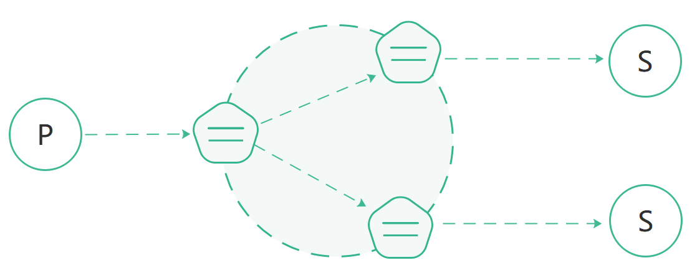
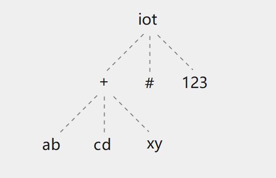

English | [简体中文](../zh_CN/cluster-raft.md)


# Raft Consensus Algorithm-Based Cluster

*RAFT* is a distributed consensus algorithm designed to achieve agreement among multiple nodes. It ensures that 
distributed systems can continue functioning even when some nodes fail, enabling reliable data storage and consistent 
services.

### Working Principle

The *RMQTT* cluster is implemented via the *rmqtt-cluster-raft* plugin. Each node in the cluster runs an instance of 
*RMQTT* and communicates with other nodes in the cluster to share information such as client connection states and 
subscription relationships. This enables the cluster to automatically distribute load across nodes and provide high 
availability in the event of node failures.

The *RMQTT* cluster maintains multiple replicas of data across different nodes to provide redundancy. Even if some 
nodes fail, the data remains available on other nodes within the cluster.

In a cluster architecture, you can add new nodes to the cluster as your business grows, providing scalability. This 
allows you to handle an increasing number of clients and messages without worrying about the limitations of a single 
broker.

### *RMQTT* Distributed Cluster Architecture

The core functionality of the *RMQTT* distributed cluster is to forward and publish messages to subscribers, as 
illustrated in the diagram below.



The *RMQTT* cluster primarily maintains the following data structures:

- Topic Tree
- Subscription Relationships

### Topic Tree

The topic tree is a hierarchical data structure that stores information about the topic hierarchy and is used to match 
messages with subscribed clients.

The topic tree is replicated across all nodes in the cluster. Below is an example of a *topic tree*:

| Client | Node | Subscribed topic   |
| ---- | --------- |--------------------|
| client1 | node1    | iot/+/ab, iot/+/cd |
| client2 | node2    | iot/#              |
| client3 | node3    | iot/+/xy, iot/123  |



### Subscription Relationships: Topic-Subscriber

*RMQTT* maintains a subscription relationship table to store the mappings between topics and subscribers, ensuring that 
incoming messages are correctly routed to the corresponding clients. The subscription relationships are replicated across 
all nodes in the cluster, and the structure is similar to the following:

```bash
    topic1 -> client1(node1), client2(node2)
    topic2 -> client3(node3)
    topic2 -> client4(node4)
```

### Message Dispatch Flow

When an MQTT client publishes a message, the node it is located on will search the topic tree based on the message's 
topic and retrieve the matching subscription topic filters. Then, it will query the subscription relationship table 
to find all subscribers and their respective nodes, forwarding the message to the corresponding nodes.

The node that receives the message will then forward the message to the corresponding subscribers.

For example, when Client 1 publishes a message to the topic `iot/123`, the message routing and distribution between 
nodes is as follows:

1. Client 1 publishes a message with the topic `iot/123` to Node 1.
2. Node 1 queries the topic tree and matches the topic `iot/123` with the `iot/#` topic filter.
3. Node 1 queries the subscription relationship table and finds:
    - Client `client2` on Node 2 has subscribed to the `iot/#` topic;
    - Client `client3` on Node 3 has subscribed to the `iot/123` topic. Therefore, Node 1 forwards the message to both Node 2 and Node 3.
4. Node 2 receives the forwarded `iot/123` message and forwards it to client2.
5. Node 3 receives the forwarded `iot/123` message and forwards it to client3.
6. The message publishing is complete.


### Plugin:

```bash
rmqtt-cluster-raft
```

#### Plugin Configuration File:

```bash
plugins/rmqtt-cluster-raft.toml
```

#### Plugin Configuration Options:
```bash
##--------------------------------------------------------------------
## rmqtt-cluster-raft
##--------------------------------------------------------------------

#cluster raft worker threads
worker_threads = 6

#grpc message type
message_type = 198
# The list of gRPC addresses for the nodes in the cluster.
# Each entry contains the node ID (e.g., 1, 2, 3) followed by the corresponding IP address and port.
# These addresses are used for communication between the nodes using gRPC.
node_grpc_addrs = ["1@127.0.0.1:5363", "2@127.0.0.1:5364", "3@127.0.0.1:5365"]
#Maximum number of messages sent in batch
node_grpc_batch_size = 128
##Client concurrent request limit
node_grpc_client_concurrency_limit = 128
##Connect and send to server timeout
node_grpc_client_timeout = "10s"

# The list of Raft peer addresses for the nodes in the cluster.
# Each entry contains the node ID and the corresponding IP address and port for Raft consensus communication.
# These addresses are used by the Raft protocol to maintain consistency and coordination across the nodes.
raft_peer_addrs = ["1@127.0.0.1:6003", "2@127.0.0.1:6004", "3@127.0.0.1:6005"]

#Raft cluster listening address
#If this listening address is not specified, the address of the node corresponding to `raft_peer_addrs` will be used.
#laddr = "0.0.0.0:6003"

# Specify the node that bootstraps a brand-new Raft cluster (bootstrap hint).
#
# 0 (default) = no designated bootstrapper. Each node probes its peers once at
# startup; if no leader is reachable yet, it bootstraps its own single-node
# cluster. Starting all nodes in parallel (Kubernetes StatefulSet with
# podManagementPolicy: Parallel, docker compose up, whole-cluster restart) can
# therefore create independent clusters that never merge.
#
# For parallel/cold starts, pin this on EVERY node to the same fixed ID that
# exists in `raft_peer_addrs` (e.g. leader_id = 1), or pass the same
# `--raft-leader-id 1` to every process. The pinned node bootstraps; the
# others poll for a live leader (60 rounds x 500 ms = ~30 s) and join it.
# Once a cluster exists, leadership may move freely: this value is only a
# bootstrap hint (see #417 / #418).
#
# It can also be overridden via the CLI flag `--raft-leader-id`.
#
# Default value: 0
leader_id = 0

#Handshake lock timeout
try_lock_timeout = "10s"
task_exec_queue_workers = 500
task_exec_queue_max = 100_000

#algorithm used to compress the snapshot, value: zstd,lz4,zlib,snappy
compression = "zstd"

#Check the health of the node, and automatically terminate the program if the node is abnormal.
#Default value: false
health.exit_on_node_unavailable = false
#Exit code on program termination.
#Default value: -1
health.exit_code = -1
#When exit_on_node_unavailable is enabled, the program will terminate after a specified number of consecutive node failures.
#Default value: 2
health.max_continuous_unavailable_count = 2
#Cluster node unavailability check interval.
#Default value: 2 seconds
health.unavailable_check_interval = "2s"

raft.grpc_timeout = "6s"
raft.grpc_concurrency_limit = 200
raft.grpc_breaker_threshold = 5
raft.grpc_breaker_retry_interval = "2500ms"
raft.proposal_batch_size = 60
raft.proposal_batch_timeout = "200ms"
raft.snapshot_interval = "300s"
raft.heartbeat = "100ms"

raft.election_tick = 10
raft.heartbeat_tick = 5
raft.max_size_per_msg = 0
raft.max_inflight_msgs = 256
raft.check_quorum = true
raft.pre_vote = true
raft.min_election_tick = 0
raft.max_election_tick = 0
raft.read_only_option = "Safe"
raft.skip_bcast_commit = false
raft.batch_append = false
raft.priority = 0

```

- `'node_grpc_addrs'` is primarily used for message forwarding during publish, while `'raft_peer_addrs'` is used for 
   synchronizing raft cluster messages.

- `'laddr'` specifies the Raft listening address. If not specified, it will default to the address configured in `'raft_peer_addrs'`.

- `'leader_id'` is a **bootstrap hint**: it names the node that bootstraps a brand-new cluster. With the default `0` there is no designated bootstrapper — each node probes its peers once at startup and, if no leader is reachable, bootstraps its own single-node cluster. On parallel cold starts this can create independent clusters that never merge. Pin the same fixed ID (present in `'raft_peer_addrs'`) on every node, or pass the same `--raft-leader-id` to every process; see the *Parallel cold starts* section below. Once a cluster exists, leadership may move freely.

- `'compression'` specifies an algorithm for compressing snapshots. Possible values are: `zstd`, `lz4`, `zlib`, 
   and `snappy`. If not set, no compression will be performed.

- `'health'` configures the behavior when a node becomes unavailable. Currently, there are two options:
    - The first is to ignore (default), with no action taken.
    - The second is to exit the program, facilitating client reconnections through load balancing devices (such as LB) 
      to other healthy nodes. It is necessary to configure health checks for load balancing devices to notify maintenance 
      personnel in a timely manner.


By default, this plugin is not enabled. To activate it, you must add the `rmqtt-cluster-raft` entry to the
`plugins.default_startups` configuration in the main configuration file `rmqtt.toml`, as shown below:
```bash
##--------------------------------------------------------------------
## Plugins
##--------------------------------------------------------------------
#Plug in configuration file directory
plugins.dir = "rmqtt-plugins/"
#Plug in started by default, when the mqtt server is started
plugins.default_startups = [
    #"rmqtt-plugin-template",
    #"rmqtt-retainer",
    #"rmqtt-auth-http",
    #"rmqtt-cluster-broadcast",
    "rmqtt-cluster-raft",
    #"rmqtt-sys-topic",
    #"rmqtt-message-storage",
    #"rmqtt-session-storage",
    #"rmqtt-bridge-ingress-mqtt",
    #"rmqtt-bridge-egress-mqtt",
    #"rmqtt-bridge-ingress-kafka",
    #"rmqtt-bridge-egress-kafka",
    #"rmqtt-bridge-egress-pulsar",
#    "rmqtt-bridge-ingress-pulsar",
    "rmqtt-web-hook",
    "rmqtt-http-api"
]
```

### Parallel cold starts (Kubernetes StatefulSet)

With the default `leader_id = 0`, starting all replicas at once
(`podManagementPolicy: Parallel`, `docker compose up`, or a whole-cluster
restart) can leave several nodes each bootstrapping its own single-node Raft
group, because none of them can reach a leader yet. Those groups never merge,
so messages are not forwarded between them — see
[issue #550](https://github.com/rmqtt/rmqtt/issues/550).

For parallel starts, pin the **same** fixed ID on every replica and make sure
that ID exists in `raft_peer_addrs`. The minimal StatefulSet below derives the
node ID from the pod ordinal (`+1` because `0` is the "no designated
bootstrapper" sentinel) and pins node `1`:

```yaml
apiVersion: apps/v1
kind: StatefulSet
metadata:
  name: rmqtt
spec:
  serviceName: rmqtt-raft        # headless Service: stable per-pod DNS
  replicas: 3
  podManagementPolicy: Parallel
  selector:
    matchLabels: { app: rmqtt }
  template:
    metadata:
      labels: { app: rmqtt }
    spec:
      containers:
        - name: rmqtt
          image: rmqtt/rmqtt:<version>  # replace with your rmqtt version
          command: ["/bin/sh", "-c"]
          args:
            - |
              ordinal=${HOSTNAME##*-}
              id=$((ordinal + 1))
              exec /app/rmqtt/rmqtt-bin/rmqttd \
                --id "$id" \
                --plugins-default-startups "rmqtt-cluster-raft" \
                --node-grpc-addrs "1@rmqtt-0.rmqtt-raft:5363" "2@rmqtt-1.rmqtt-raft:5363" "3@rmqtt-2.rmqtt-raft:5363" \
                --raft-peer-addrs "1@rmqtt-0.rmqtt-raft:6003" "2@rmqtt-1.rmqtt-raft:6003" "3@rmqtt-2.rmqtt-raft:6003" \
                --raft-leader-id 1
```

Notes:

- Create a headless Service (`clusterIP: None`) named `rmqtt-raft` (not shown);
  it gives each pod a stable DNS name, so all replicas can use the same ports.
  Keep the two address lists identical on every replica; only `--id` is derived
  per pod, and `replicas` must match the number of entries in both lists. If
  the pinned ID is missing from `raft_peer_addrs`, plugin startup fails with
  `Leader does not exist`.
- Nodes other than the pinned one poll for a live leader for 60 rounds x
  500 ms (~30 s). If pod `rmqtt-0` is slower than that (image pull, PVC attach),
  those pods fail plugin initialization and must be restarted by the
  orchestrator. `podManagementPolicy: OrderedReady` (the default) starts pod-0
  first, so pods 1/2 begin only after pod-0 is running and the wait has to cover
  just the bootstrap itself.
- A non-zero `leader_id` is only a bootstrap hint. Once the cluster exists,
  Raft may elect any node, and a restarted node joins whoever is leader at that
  moment (see [#417](https://github.com/rmqtt/rmqtt/issues/417) /
  [#418](https://github.com/rmqtt/rmqtt/pull/418)). Passing
  `--raft-leader-id 0` explicitly restores the unpinned behaviour.
- `--plugins-default-startups` above enables only the Raft plugin for brevity;
  in production list all required plugins in `rmqtt.toml`'s
  `plugins.default_startups` instead.
